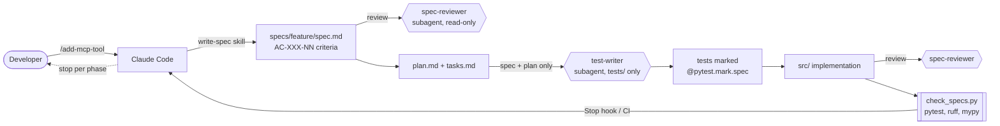

# expense-tracker

A small personal expense tracker exposed as an **MCP server**, built
with Claude Code through a **spec-driven development (SDD)** workflow.

The product is deliberately small. The interesting part is the
process: how the agent is configured, constrained and checked, and
what went wrong along the way. Read the git history in order: every
feature goes `spec:` -> `plan:` -> `tasks:` -> `test:` -> `feat:`.

All data in this repository is fictitious.

## Quick start

```bash
python3 -m venv .venv
.venv/bin/pip install -e ".[dev]"
.venv/bin/pytest
```

No API keys are needed. To use the server from Claude Code, open the
project and approve the `expense-tracker` server from `.mcp.json`
(`/mcp`). The optional `github` server needs `GITHUB_PAT` set to a
fine-grained token; without it, it simply does not connect.

## MCP tools

| Tool | Spec | What it does |
| --- | --- | --- |
| `add_expense(amount, description, date?, category?)` | [add-expense](specs/add-expense/spec.md) | Records one expense in EUR. Amount as text or number (`"12.50"`, `"12,50"`, `19.99`); date defaults to today and cannot be in the future; category is suggested by the categorizer when omitted. Returns the stored expense; invalid input returns a tool error with the exact reason. |
| `list_expenses(date_from?, date_to?, category?, limit?)` | [list-expenses](specs/list-expenses/spec.md) | Lists stored expenses, most recent first, with optional inclusive date range and category filters. `limit` is 50 by default and 200 at most; `total_count` says how many expenses matched before the limit. Invalid input returns a tool error with the exact reason. |
| `monthly_report(month?, compare_to?)` | [monthly-report](specs/monthly-report/spec.md) | Summarises one month (default: the current one): total, number of expenses, and total, count and percentage per category. Compares it with another month (default: the previous one), overall and per category, with signed differences (`"+28.60"`, `"-730.80"`). Months from 1900-01; invalid input returns a tool error with the exact reason. |

Next: comparing a month with the average of the last X months, as a
second iteration of the monthly-report spec.

## Optional: categorize with Claude

By default `add_expense` suggests a category from a few keywords
("train" -> `transport`), so most descriptions end up as `other`.
The [llm-categorizer](specs/llm-categorizer/spec.md) feature asks
Claude (`claude-haiku-5-5`) instead. It is opt-in
([ADR 5](docs/adr/0005-opt-in-llm-categorizer.md)):

- **What leaves your machine**: only the expense description and the
  category list, sent to the Anthropic API. Never amount or date.
- **When it fails** (timeout after 10 s, HTTP error, refusal, an
  answer outside the list), the keywords decide and the server writes
  one line to stderr. `add_expense` never fails because of it.

1. Install the SDK (the `dev` extra already includes it):
   `.venv/bin/pip install -e ".[llm]"`.
2. Give the server Anthropic credentials, outside the repository:
   - **`ant auth login`** (recommended). Install the `ant` CLI from
     [anthropics/anthropic-cli](https://github.com/anthropics/anthropic-cli/releases)
     (macOS: `brew install anthropics/tap/ant`; with Go 1.25+:
     `go install github.com/anthropics/anthropic-cli/cmd/ant@latest`),
     then run `ant auth login` and check with `ant auth status`. The
     credential is a profile in `~/.config/anthropic/`; the SDK finds
     it without any environment variable. A profile is ignored while
     `ANTHROPIC_API_KEY` is set, and Claude Code may warn about an
     auth conflict with its own login: keep one of the two.
   - **`ANTHROPIC_API_KEY`** exported in the shell that starts the
     server, read from a password manager or keyring. Claude Code
     itself also uses this variable when it is set.
   - Never put a key in the repository, in `.env` (nothing loads it)
     or in `.mcp.json`.
3. Start the server (or Claude Code) with
   `EXPENSE_TRACKER_CATEGORIZER=anthropic`. `.mcp.json` passes it
   through and defaults to `keywords`.

With a bad configuration the server does not start: it exits with
status 1 and one message on stderr (unknown value, `llm` extra not
installed, or no credentials found). A key that exists but is wrong
is only noticed per request, as keyword categories plus a stderr
line.

Checked by hand from Claude Code with a real account: the credential
reaches the server and a real API error falls back to keywords. Not
yet checked: a successful answer from the real API (the account had
no credits; task T14 in the
[tasks](specs/llm-categorizer/tasks.md)).

## How the agent works here



| Piece | Where | What it does |
| --- | --- | --- |
| Shared rules | `AGENTS.md` | Commands, domain rule, SDD flow, security, definition of done. Tool-neutral. |
| Claude rules | `CLAUDE.md` | Imports `AGENTS.md`, adds which skill/subagent to use when. |
| Permissions | `.claude/settings.json` | Explicit allow list (no `Bash(*)`); deny `.env*`, `secrets/`, `git push`, `curl`, `rm -rf`. |
| PreToolUse hook | `.claude/hooks/block_secrets.py` | Blocks Bash commands that touch secrets or dump the environment (exit 2). |
| PostToolUse hook | `.claude/hooks/format_python.py` | `ruff format` + `ruff check --fix` on every edited `.py`; reports unfixable lint to the agent. |
| Stop hook | `.claude/hooks/stop_checks.py` | Runs the definition of done (ruff format/check, mypy, pytest, spec validator, same as CI); on failure the agent must keep working (once, to avoid loops). |
| Skill | `.claude/skills/write-spec` | How to write verifiable, ID-tagged acceptance criteria. |
| Skill | `.claude/skills/add-mcp-tool` | The full SDD flow with a commit per phase; the developer reviews and accepts the tests and the code before they are committed. User-invoked only. |
| Subagent | `.claude/agents/spec-reviewer.md` | Independent, read-only review of a spec or a finished feature. |
| Subagent | `.claude/agents/test-writer.md` | Writes tests from spec + plan, blind to `src/`. |
| Spec validator | `scripts/check_specs.py` | Every AC of an implemented spec has a test; every test mark points to a real AC. |
| MCP | `.mcp.json` | This project's own server (stdio) + GitHub's official server (HTTP). |
| CI | `.github/workflows/ci.yml` | ruff, mypy, pytest, spec validator, gitleaks over the full history. |

### Why these are subagents and not skills

A **skill** is a procedure loaded into the main conversation: it shares
the context and the tools of the agent doing the work. That is right
for `write-spec` and `add-mcp-tool`, which need the conversation with
the user and the full toolset.

A **subagent** runs in its own context with its own tool list. Each of
ours needs that isolation for a concrete reason:

- **spec-reviewer**: a review is only useful if it is independent. In
  the main context the reviewer would share the author's reasoning and
  blind spots. As a subagent it starts from the files, not from the
  author's summary, and has no `Write`/`Edit` tools, so it cannot
  "fix" things quietly instead of reporting them.
- **test-writer**: tests written by someone who has read the code tend
  to assert what the code does, not what the spec asks. A hook in its
  frontmatter (`test_writer_guard.py`) blocks reading `src/` and
  writing outside `tests/`. That restriction is impossible to express
  for a skill, which runs with the main agent's permissions.

A third candidate, a security reviewer, was dropped: finding secrets
is better done by deterministic tools (deny rules, the PreToolUse
hook, gitleaks in CI) than by an LLM.

## Architecture

A monolith with one rule: the domain imports no infrastructure
([ADR 1](docs/adr/0001-functional-core-and-single-llm-port.md)),
enforced by `tests/test_domain_purity.py`.

```
src/expense_tracker/
  domain/     pure rules; Categorizer protocol (the only port)
  adapters/   SQLite storage; keyword and Claude categorizers
  startup.py  picks the categorizer from the environment
  server.py   MCP tools: parse input -> domain -> storage -> output
```

Decisions: [docs/adr](docs/adr).

## What went wrong and what I learned

Kept up to date as the project goes. Each entry says what happened,
why, and what changed.

1. **The agent picked a non-PEP 8 line length.** The first
   `pyproject.toml` used `line-length = 100`; the developer asked for
   PEP 8. Now: 79/72 columns and pep8-naming in ruff, and PEP 8 is a
   rule in `AGENTS.md`, so it does not depend on the agent's memory.
   Lesson: style preferences that are not written down get replaced
   by the model's defaults.
2. **Near miss: MCP SDK v2 renamed `FastMCP` to `MCPServer`.** The
   agent's habits (and most tutorials) are v1. Checking the current
   docs before coding, and then the installed package's source,
   caught it. `import mcp.server.fastmcp` now fails with a pointer to
   the migration guide.
3. **SDK v2 hides exception messages from tool errors.** A smoke test
   showed `ValueError("amount must be positive")` reaching the client
   as just "Error executing tool add". Only `ToolError` keeps its
   message. Recorded in ADR 3 and in the `add-mcp-tool` skill so the
   plan for every tool includes error mapping.
4. **A hook test that could not fail.** To test the Stop hook, the
   agent created a failing test named `hook_probe_tmp.py`; pytest
   only collects `test_*.py`, so the hook "passed". Lesson: before
   trusting a passing check, see it fail once.
5. **Outdated assumption about `.mcp.json`.** The agent assumed an
   unset `${GITHUB_PAT}` would break the whole file. The current docs
   say the config still loads with a warning for that server only;
   `claude mcp list` confirmed it.
6. **Hooks run before permission rules.** In the live test,
   `cat .env` was stopped by the PreToolUse hook, not by the
   `Read(./.env)` deny rule. Both layers stay (ADR 4), but the order
   matters when reading logs.

7. **The first spec draft was "happy" about edge cases.** The
   agent's draft of `add-expense` had 17 criteria and looked
   complete. The `spec-reviewer` subagent, reading it cold, found 10
   major gaps a test writer would have had to guess about: a JSON
   number like 19.99 becomes a float that `Decimal()` turns into
   19.98999..., `"NaN"` crashes the comparison, `"1e30"` overflows the
   INTEGER column and reaches the client as an opaque error, plus
   undefined trimming, blank optionals, validation order and a
   non-strict date format (`20261001` passes `fromisoformat`). The
   same model that wrote the spec missed all of it; a separate
   context caught it. Business decisions (future dates, max amount,
   comma separator) went to the developer, not to the agent.
8. **Then the reviewer over-split.** Its second pass asked to split
   criteria by code path (`null` vs `""` vs missing), which took the
   spec to 34 criteria. The developer pushed back: many had the same
   outcome. Rule now in `write-spec` and `spec-reviewer`: one
   criterion per observable outcome, listing every example value,
   and tests must cover all values (the reviewer checks that, since
   `check_specs.py` only counts one test per criterion). Result: 23
   criteria. Lesson: a reviewer agent optimises for what its prompt
   rewards; "one behaviour" was read as "one code path".
9. **The secrets hook ignored environment variables.** While
   explaining how to set `GITHUB_PAT` for the GitHub MCP server, the
   agent checked its own hook and found `echo $GITHUB_PAT` allowed:
   only files and `printenv` were covered, yet the agent's Bash
   inherits Claude Code's environment. Fixed test-first (13 new
   blocked cases, 6 must-stay-allowed ones such as `$PATH`); names
   are matched by `_`-separated parts so `PATH` is not `PAT`.
   Lesson: threat-model where the secret actually lives, not only
   where secrets usually are. Immediate side effect: the commit for
   this fix was blocked, because its heredoc message quoted the
   command. The agent now writes commit messages to a file and runs
   `git commit -F <file>` instead of weakening the hook.
10. **ruff formats Python inside Markdown.** `ruff format --check .`
    failed on `specs/add-expense/plan.md` because ruff 0.16 also
    formats fenced code blocks in `.md` files. It slipped in because
    the Stop hook runs pytest and the spec check, not the formatter
    check; CI would have failed on the first push. Fixed by
    formatting the plan, and the Stop hook now runs the same checks
    as CI (about 3 s), with stub-based tests for its behaviour.
    Lesson: a local gate that checks less than CI moves failures to
    the slowest feedback loop.
11. **Green on the first run did not mean done.** All 133 tests
    passed at the first implementation attempt, yet the feature
    review found a scale-blind assertion (`Decimal("12.5") ==
    Decimal("12.50")` is true, so AC-ADD-03 could not catch a store
    that lost the cents format) and a crash: Python refuses `str()` on
    ints over 4300 digits, so a JSON amount of 10^5000 reached the
    client as an opaque error. The fix followed the flow: the
    developer approved spec changes, test-writer added the cases (the
    10^5000 one went red), then the code changed.
12. **A subagent's report is not evidence.** test-writer reported
    having written the Arabic-Indic digits as an escape; the file had
    the literal characters. Harmless here, but from then on the main
    agent checks files, not summaries.
13. **"All checks passed" can be stale.** The committed red-step
    tests (including `conftest.py`) failed ruff's import sorting with
    `--no-cache`, but passed with the local cache: ruff decides which
    imports are first-party by looking at the files on disk, and the
    cached results came from before the imported modules existed.
    CI, which has no cache, would have failed. Fixed with
    `ruff check --fix --select I`, and the Stop hook now runs
    `ruff check --no-cache` so the local gate matches CI.
14. **The agent assumed the repo had never been pushed.** While
    proposing to rewrite history to replace a personal email in
    the commits, the agent said "nothing has been pushed yet"
    without checking `git remote`. The developer's own `git push`
    showed an `origin` already holding all commits. The repo was
    private, so the plan changed to: rewrite with `filter-branch`
    (tree verified identical byte for byte), delete and recreate
    the GitHub repo so the old commits are not reachable by hash,
    push again. Lesson: check state (`git remote -v`, `git branch
    -vv`) before stating it.
15. **The secret scan in CI scanned nothing and still said "no
    leaks".** On the first push to the recreated repo,
    `gitleaks-action` scanned `<first pushed commit>^..<last>`;
    the first commit is the root, so the range was invalid, git
    failed, and the action logged "scanned ~0 bytes ... no leaks
    found in partial scan" before exiting with an error. Without
    that error it would have been a silent false negative. CI now
    runs the gitleaks CLI (checksum verified) with `gitleaks git .`,
    the same full-history scan validated locally. Lesson: when a
    security check passes, look at what it actually scanned.
16. **The first test dataset could not prove the sort order.** The
    `list-expenses` spec stored its example rows in date order, so an
    implementation ordering by id alone would have passed every
    criterion. The reviewer caught it; row 6 is now stored last but
    dated earlier. The same spec said "future dates are allowed" in a
    spec whose sibling rejects them; the reviewer called it
    consistent, the developer found it confusing, and the sentence
    now explains why a future bound is harmless. Lesson: a reviewer
    checks verifiability, not whether a human can read it.
17. **A test that passed before the implementation existed.** In the
    red step, the 14 "listing never changes stored data" cases passed
    with no tool at all (`Unknown tool` is an error, and nothing
    changed). The agent's report did not mention it; counting passes
    in the red run did. Two rounds with test-writer: assert the
    expected outcome, then the exact error message. Lesson: in the
    red step, every test must be seen failing, not most.
18. **The cache lesson came back, this time predicted.** Test files
    importing a module that does not exist yet get their imports
    grouped as third-party; once it exists, ruff wants them
    regrouped (entry 13). A copy of the repo with a stub module
    confirmed it before implementing, and the mechanical fix
    (`ruff --fix --select I`, imports only) was recorded in the
    commit.
19. **A textual guard has false positives.** `block_secrets.py`
    blocked two harmless commands of the agent because they contained
    the word `secrets` (a CI job name) and `set(` (Python code in a
    heredoc). Both were solved by moving the text to a file, not by
    loosening the hook. That is the cost of guarding on command text
    (ADR 4): an occasional detour is cheaper than a hole.
20. **Right numbers, wrong examples.** After entry 16, the agent
    computed every expected value of the `monthly-report` spec with a
    script before writing it, and the reviewer confirmed all of them.
    It still found gaps: no expense on a 31st or on 29 February, a
    year 0000 that the format accepted but no date can hold, and a
    rounding example that floats also get right (6.25 is exact in
    binary; 0.29 of 4.00 = 7.25 is not, so it was added). Lesson:
    checking the arithmetic does not check that the examples can
    tell a correct implementation from a plausible wrong one.
21. **The agent's own brief was wrong.** The prompt to test-writer
    said AC-RPT-13 had eleven values; after an edit to the spec it
    had ten. The subagent tested the ten in the spec and reported
    the mismatch instead of inventing an eleventh. Lesson: the spec,
    not the brief, is the contract; and a brief written from memory
    drifts from the file.
22. **A pattern outlived its reason.** `conftest.py` imported
    production modules inside each fixture, a trick that only
    matters while a module does not exist yet. Every new fixture
    copied it, so the same imports appeared three times. The
    developer spotted it in review; imports moved to the top and the
    docstring now states the one case where the trick still applies.
    Lesson: when copying a pattern, check the reason still holds.
23. **The agent started a phase nobody launched.** Asked to "continue
    with the categorizer", the agent asked the scope questions (good)
    and then wrote the spec on its own (bad): the workflow starts
    when the developer runs `/add-mcp-tool`. The developer deleted
    the file and launched the skill. The rule now lives in the
    agent's memory. Lesson: a question about the next feature is not
    the start of the next feature.
24. **Library defaults are requirements too.** The first
    llm-categorizer spec said "no retries" but only listed HTTP
    errors; the Anthropic SDK also retries timeouts by default, so an
    implementation could keep those retries and pass. The reviewer
    found it, plus an undefined answer format and a timeout no test
    could observe. Before the plan, the agent probed the SDK in a
    throwaway venv (timeout per request, retry rules, error classes,
    what "no credentials" looks like) instead of trusting memory, so
    the plan's contract was checked before test-writer coded against
    it. Lesson: when a dependency has defaults, the spec has to name
    the cases where the defaults would bite.
25. **A rule with no criterion is not tested.** The spec said
    "`add_expense` never fails because of the LLM", and all 305 tests
    passed, but every failure listed in the criteria was an error
    reply or a bad answer text. The feature review tried a success
    reply whose body is not a message (`not json`, `{}`, a proxy's
    HTML page): the SDK raised, the port broke its "never raises"
    contract and `add_expense` failed. The developer chose to amend
    the spec (AC-LLM-15) and go through red and green again, not to
    patch the code quietly. The final review found one more (an
    answer text that is a number or null) and the same round was
    repeated. Lesson: every promise in a spec's prose needs a
    criterion that would break it.
26. **A safe log line can hide the cause.** In the manual check the
    stderr line said `BadRequestError`: a 400 can mean no credits or
    a request the model rejects, and the line, built to never leak
    data, cannot tell them apart. A one-off script printing the API's
    error message showed it was the credit balance. Lesson: decide
    up front which diagnostic detail is safe to log (here, the API's
    error type and message), instead of discovering the gap during a
    live check.

### Manual hook verification (phase 2)

Done live in a Claude Code session on this repo, besides
`tests/test_hooks.py`:

- `Write .env` -> refused by the `Edit(./.env)` deny rule.
- `cat .env`, `grep TOKEN .env`, `python3 -c "open('.env')"` ->
  blocked by `block_secrets.py` (exit 2, reason shown to the agent).
- Writing a badly formatted `.py` -> reformatted by
  `format_python.py`, unused imports removed.
- Ending a turn with a deliberately failing test -> `stop_checks.py`
  blocked the stop and fed the pytest failure back; the agent removed
  the test and the next stop passed.

## License

[MIT](LICENSE).
